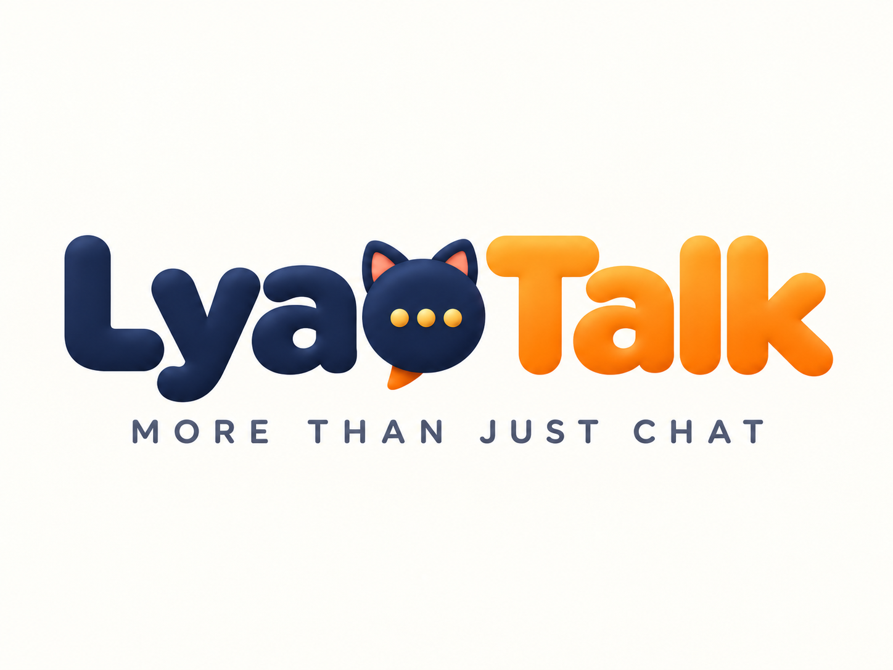
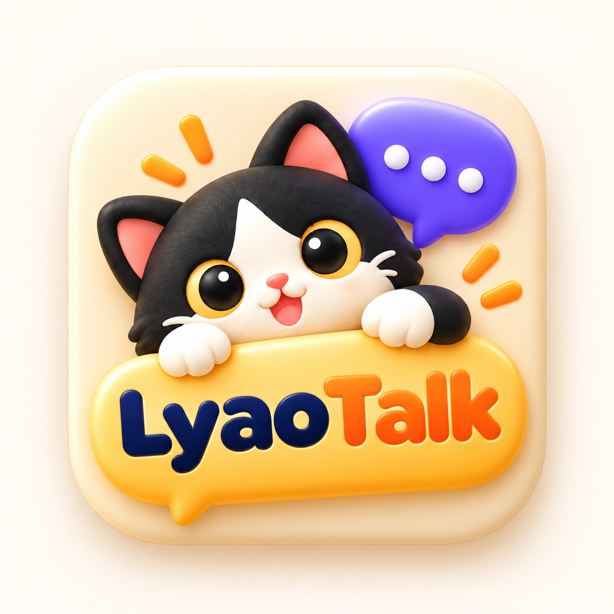

  

# Lyao Talk

**More Than Just Chat.**

Lyao Talk is an open-source XMPP-based web messaging app, built with React, TypeScript, FastAPI and Prosody.

  

## Development

- Frontend: `apps/web` (React, TypeScript, Vite)
- Backend: `apps/api` (FastAPI)
- Messaging server: Prosody
- Current application version: `2.3.5`

Run `npm --prefix apps/web ci`, `npm --prefix apps/web run build`, and `npm --prefix apps/web test` to validate the frontend.

## Deployment

See [VPS deployment and rollback instructions](docs/DEPLOYMENT.md). CI validation does not imply that the production VPS has been updated. The original LiaoT server is unchanged until a separately approved cutover.
