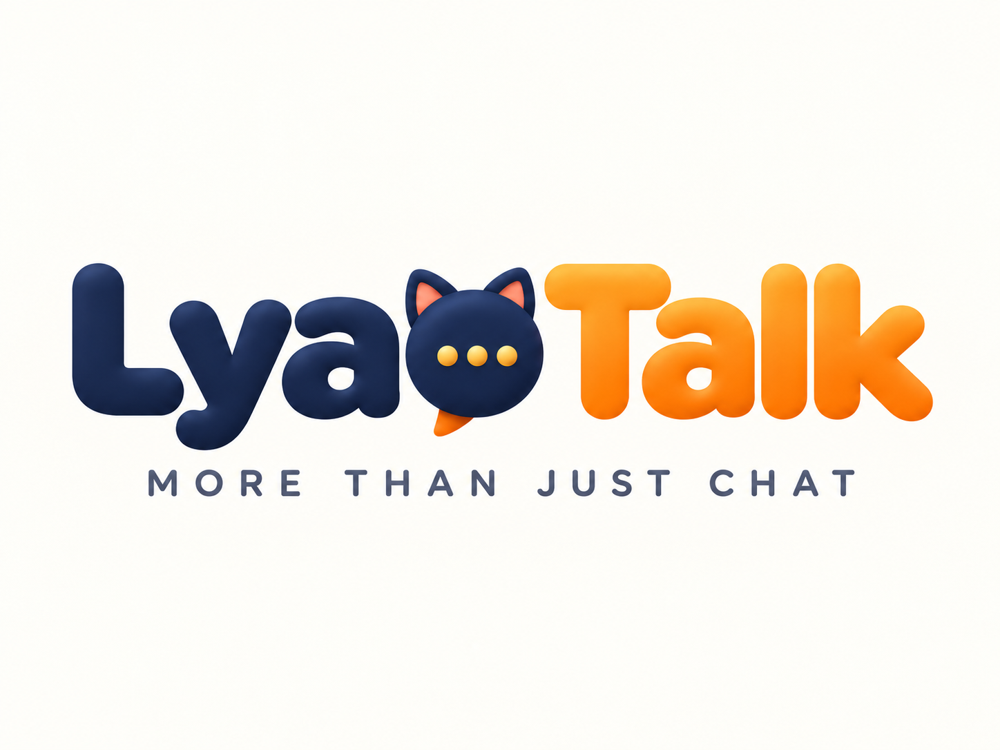
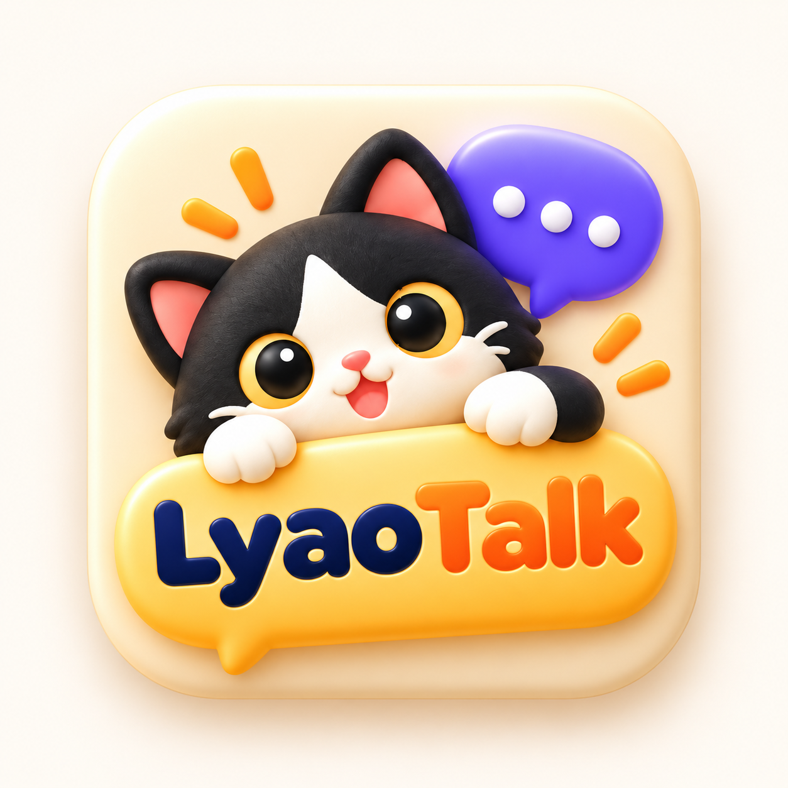

  

# Lyao Talk

**More Than Just Chat.**

Lyao Talk is an open-source XMPP-based web messaging app, built with React, TypeScript, FastAPI and Prosody.

  

## Development

- Frontend: `apps/web` (React, TypeScript, Vite)
- Backend: `apps/api` (FastAPI)
- Messaging server: Prosody
- Current application version: `2.3.7`

Run `npm --prefix apps/web ci`, `npm --prefix apps/web run build`, and `npm --prefix apps/web test` to validate the frontend. CI also audits production npm dependencies and the hash-locked Python dependencies on every push and pull request.

## Deployment

For a fresh installation on your own infrastructure, see the [deployment guide](docs/DEPLOYMENT.md). Production infrastructure details are maintained privately.
